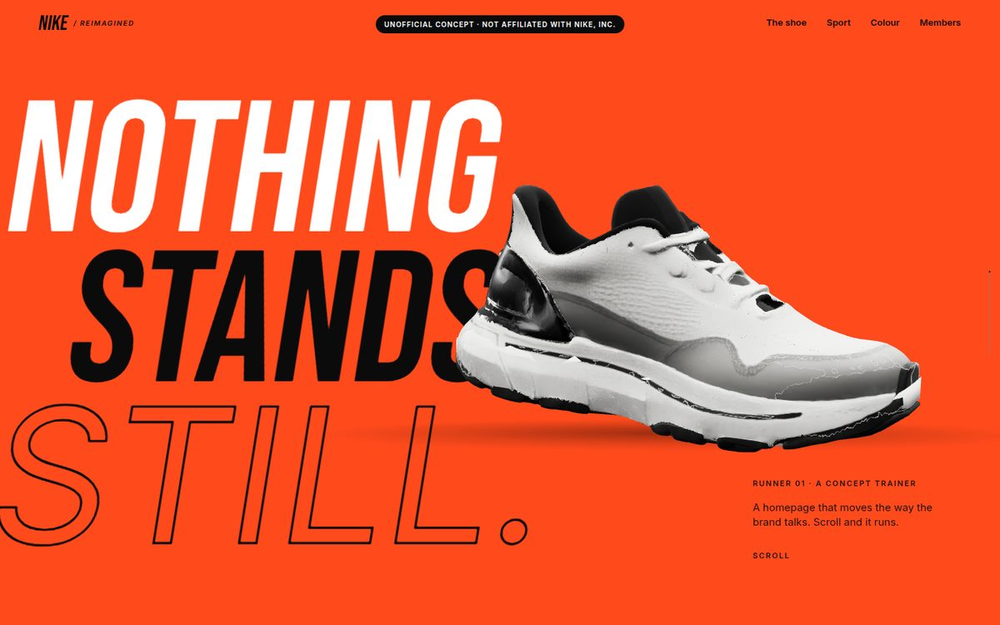
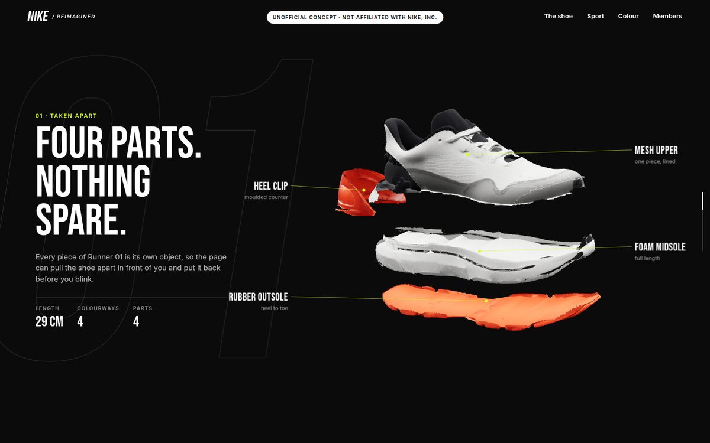
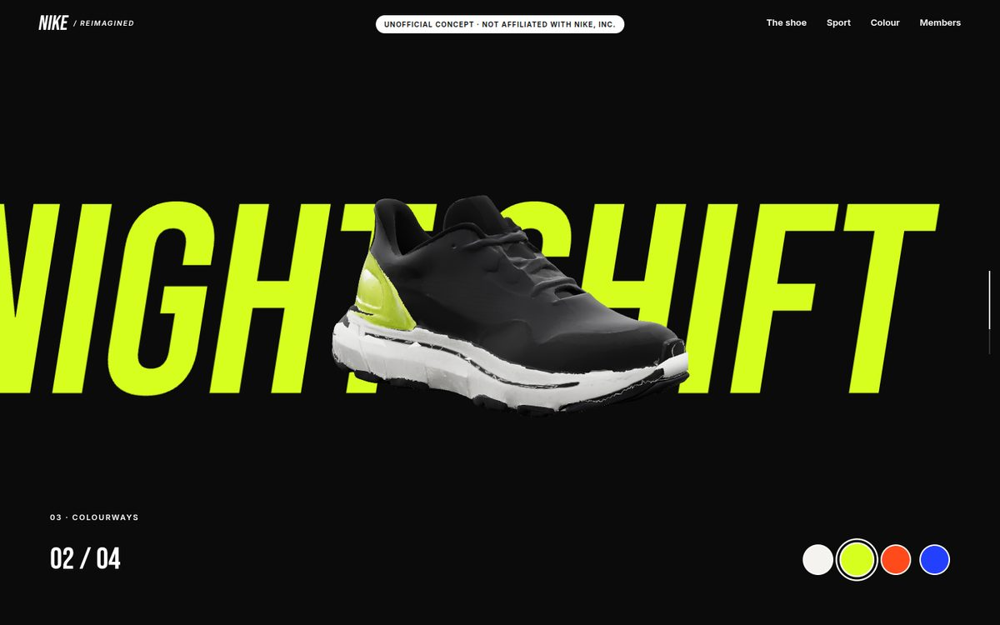
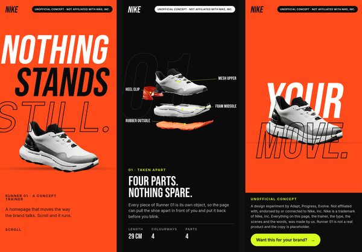

# Brand homepage, reimagined

A scroll-driven 3D concept homepage. One original trainer is taken apart, run through four sports, recoloured four times and handed back to you, all from the scroll bar. Vite + React + Three.js, no animation library, about 220 kB of gzipped JavaScript plus a 1.6 MB model.

**Live demo:** https://jstov.uk/lab/reimagined/nike

> **UNOFFICIAL CONCEPT.** This is a design study. It names Nike in plain text as the brand it studies and is not affiliated with, endorsed by or connected to Nike, Inc. Nike is a trademark of Nike, Inc. There are no logos, marks, product names or photography from the brand anywhere in this repo. The trainer ("Runner 01"), the type treatment, the scenes and the words are all ours. Runner 01 is not a real product and the copy is placeholder.

| Hero | Taken apart |
|---|---|
|  |  |
| **Colourways** | **Phone** |
|  |  |

## Run it

```bash
git clone https://github.com/StovBuilds/brand-homepage-reimagined.git
cd brand-homepage-reimagined
npm install
npm run dev        # http://localhost:5173
npm run build      # type-check + production build into dist/
npm run preview    # serve dist/
```

Node 18 or newer. `dist/` is fully static (`base: "./"`), so it runs from GitHub Pages, a sub-folder or any CDN.

Two URL switches help when you are working on it:

- `?p=0.5` pins the film at a scroll position (0 to 1) and freezes the idle motion. Good for screenshots and for checking one scene.
- `?qa=1` puts the live state (`p`, scroll velocity, current colourway and sport) on `window.__conceptQA`.

## What's in here

```
src/
  brand.ts      everything brand-specific: names, copy, colourways, model path
  Concept.tsx   the page: DOM layers, type, the scroll timeline that drives them
  stage.ts      the Three.js stage: renderer, lights, camera keys, explode, colourways, speed streaks
  main.tsx      mounts it
public/models/
  runner-hybrid.glb   the trainer the page loads (4 parts, 1.6 MB)
  runner.glb          the fully scripted trainer (7 parts, 1.3 MB)
tools/
  concept-runner.blender.py   builds runner.glb from scratch in Blender
  hybrid/                     turns an image-to-3D mesh into runner-hybrid.glb
```

## How it's built

### One scroll value drives everything

The page is a 1150vh-tall empty div with a fixed stage on top. Every frame reads one number, `p` (scroll position from 0 to 1), eases towards it, and sets everything from that: the DOM text, the background wipes, the camera, the exploded parts, the colours. Nothing is triggered by "scroll into view" events, so you can scrub backwards and forwards and every frame is the same frame each time. That is also why `?p=` can pin any moment.

The timeline lives in `T` in `src/stage.ts`:

| Scene | `p` range | What happens |
|---|---|---|
| Hero | 0.00 – 0.16 | Three lines of type split apart around the trainer |
| Wipe | 0.14 – 0.21 | A slanted black wipe takes over |
| Taken apart | 0.21 – 0.42 | The trainer explodes into its parts, with leader lines and labels tracking each part on screen |
| Run | 0.42 – 0.615 | Sport words fly through the screen, speed streaks, the shoe strides |
| Colourways | 0.63 – 0.80 | Four colourways, a circular wipe and a full spin for each |
| Members | 0.805 – 0.92 | Cards fan out |
| Finale | 0.915 – 1.00 | "YOUR MOVE." closes in from both sides; the credit and disclaimer come up |

Small helpers do the timing: `seg(a, b, p)` maps a range to 0..1, `smooth` eases it, and `pulse(a, b, c, d, p)` fades in, holds and fades out. A scene is a few lines of those.

The scroll velocity is tracked too and fed into the type's skew (`--sk`), so the type leans harder when you scroll fast.

### The stage

- One transparent WebGL canvas between two DOM layers, so big type can sit both behind and in front of the shoe.
- The shoe hangs off three nested groups: `rig` (where it sits on screen and how big), `spin` (rotation) and `model` (centimetres to scene units). Camera "keys" are positions in screen-relative units, with a separate set for narrow screens, so the same film works at 390 px and 2560 px wide.
- Lighting: a studio environment built in code (PMREM from a small scene, no HDR download), one key light and one rim light, ACES tone mapping.
- Each named part in the GLB (`upper`, `clip`, `midsole`, `outsole`, …) gets its own `MeshPhysicalMaterial`. A colourway is a map of material name to colour, and colours ease towards the target each frame, so a colour change is a blend, not a cut.
- The exploded view moves each part along its own direction vector. The label leader lines are drawn in an SVG overlay from each part's projected screen position.
- The speed field is a single `InstancedMesh` of 150 thin boxes, one draw call.
- Textures (knit, speckle, grain) are generated on a canvas at start-up rather than downloaded.

### Performance notes

- Pixel ratio is capped by a pixel budget (about 3.2 million pixels), not just `devicePixelRatio`, so a 4K screen does not render 4x the work.
- The GLBs are meshopt-compressed and quantised (`EXT_meshopt_compression`, `KHR_mesh_quantization`); three.js decodes them with `MeshoptDecoder`.
- No post-processing passes, no shadow maps (the contact shadow is a blurred texture on a plane), two lights.
- `prefers-reduced-motion` turns off the easing and the idle motion; the page still scrolls through every scene.
- No WebGL? The page falls back to the type-only version rather than a blank screen.

## The trainer: two ways to make it

Both models are ours. Neither copies a real product's shape or marks.

### 1. Fully scripted: `runner.glb`

`tools/concept-runner.blender.py` builds Runner 01 from tables of numbers: the upper's width and height along the foot, a sculpted midsole wall, lugs, a padded collar, stitching, eyelets and a heel clip. Every part is a separately named object so the page can pull them apart. It also bakes ambient occlusion into vertex colours so the creases read as real.

```bash
# Blender 4.x
blender -b -P tools/concept-runner.blender.py -- public/models/runner.raw.glb [preview-dir]
RUNNER_BAKE=0 blender -b -P tools/concept-runner.blender.py -- out.glb   # skip the AO bake: about a minute on a CPU
```

Blender exits 0 even when a script fails, so check the log ends with `GLB_DONE` and the file exists. Then compress it (below).

### 2. Hybrid: `runner-hybrid.glb` (what the page uses)

The scripted shoe is clean but a little toy-like, so the page uses a hybrid:

1. An AI-generated concept image of an unbranded trainer (`tools/hybrid/concept.png`).
2. Image to 3D with [TRELLIS](https://github.com/microsoft/TRELLIS) (MIT), on a rented GPU. Output: one fused, textured mesh.
3. `tools/hybrid/` splits that mesh into parts the page can explode and recolour:

```bash
mkdir -p tools/hybrid/work && cd tools/hybrid/work
blender -b -P ../stageA.py -- trellis.glb cls.npz . nodebug   # orient + classify faces: outsole / midsole / clip / upper
blender -b -P ../stageC.py -- trellis.glb .                   # lining + laces, smooth ragged edges, drop small islands
python3 ../tex.py trellis.glb                                 # detail texture: divide the baked lighting out, per part
blender -b -P ../stageB.py -- trellis.glb runner-hybrid.raw.glb .   # split, add solid cores, decimate, export
```

`tex.py` needs `numpy` and `Pillow`. The stages print what they found; `stageA` and `stageC` write debug renders of the face classes if you leave off `nodebug`.

Known limits of the hybrid: the laces are still part of the upper, and the classifier's thresholds are tuned for this one mesh.

### Compress for the web

```bash
npx @gltf-transform/cli meshopt in.raw.glb public/models/runner-hybrid.glb
```

## Swap in your own brand

Everything brand-specific is in `src/brand.ts`:

1. `BRAND`: the name, the owner (for the disclaimer), the wordmark text, hero lines, finale words, call-to-action link. Keep a disclaimer if you are studying a brand you don't own.
2. `SPORTS`, `CALLOUTS`, `CARDS`: the copy for each scene. `CALLOUTS[].part` must match an object name in your GLB.
3. `COLOURWAYS`: page background, text colour, swatch colour and a material-name to colour map for each colourway.
4. `BRAND.model`: point it at your own GLB. Name the parts and materials the same way (`upperMat`, `midMat`, `outMat`, `clipMat`, …), or edit the `EXPLODE` directions and material settings in `stage.ts`.

Not a shoe? The stage doesn't care what the model is. Anything with named parts can be exploded, spun and recoloured on scroll: headphones, a bike, a bottle. Retune the camera keys in `stage.ts` (`keysFor`) for its proportions.

Don't use another company's logo, marks, product names or photography unless you have the rights to them.

## Licence

Code: MIT (see `LICENSE`). The 3D models in `public/models/` and `tools/hybrid/concept.png` are ours and are not under the MIT licence; you may use them to run, study and demo this project.

Made by [Adapt Progress Evolve](https://adaptprogressevolve.com/). Built in public on [StovBuilds](https://github.com/StovBuilds).
